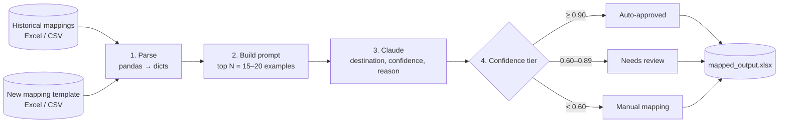
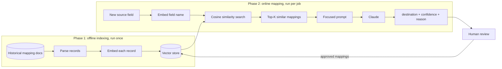
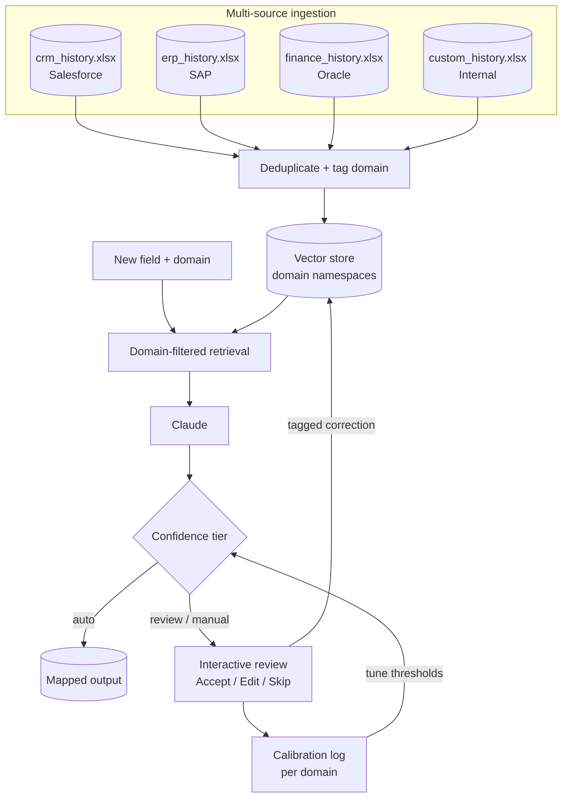

# RAG Field Mapper: Technical Design

Two solution designs, an implementation guide and an enhancement roadmap for automating source-to-destination field mapping with Retrieval-Augmented Generation (RAG) and Claude.

Version 1.0, May 2026.

## Contents

1. [Executive summary](#executive-summary)
2. [Solution A: naive few-shot mapping](#solution-a-naive-few-shot-mapping)
3. [Solution B: RAG-powered mapping](#solution-b-rag-powered-mapping)
4. [Project structure and running locally](#project-structure-and-running-locally)
5. [Enhanced design: multi-source with interactive feedback](#enhanced-design-multi-source-with-interactive-feedback)
6. [Solution comparison](#solution-comparison)
7. [Migration guide](#migration-guide)
8. [Appendix](#appendix)

## Executive summary

The RAG Field Mapper is an AI-powered data integration tool that automates mapping source fields to destination fields across enterprise systems. It combines Retrieval-Augmented Generation with the Claude LLM to produce context-grounded field mappings at scale, reducing manual mapping effort by 60–80%.

> **Purpose:** automate field-level data mapping across CRM, ERP, Finance and custom systems by learning from historical mapping decisions and applying that knowledge to new mapping tasks.

| Metric | Naive few-shot | RAG approach |
|---|---|---|
| Context quality | Fixed top-N examples | Semantically nearest per field |
| Scales to 10k+ records | No, hits token limits | Yes, only top-K retrieved |
| Naming variations | Weak | Strong, embeddings capture meaning |
| Improves over time | Manual prompt edits | Re-indexing approved mappings |
| Explainability | Uses examples 1–20 | Similarity scores per retrieval |

## Solution A: naive few-shot mapping

The naive approach loads a fixed number of historical examples directly into the LLM prompt, then asks the model to map new fields based on those examples. It is the simpler of the two designs: quick to set up, no vector database required.

### Architecture



The pipeline runs four stages in sequence for each batch job:

1. **Parse:** read historical and new mapping documents from Excel/CSV into Python dicts.
2. **Prompt:** inject the top N historical examples (15–20) directly into a structured prompt.
3. **LLM call:** send the prompt to Claude and receive destination field, confidence and reasoning.
4. **Output:** write results to Excel, split by confidence tier (auto / review / manual).

### Implementation

**Step 1: parse documents.** Convert the Excel files into Python dictionaries with pandas.

```python
import pandas as pd

def parse_mapping_doc(filepath):
    df = pd.read_excel(filepath, dtype=str).fillna('')
    return df.to_dict(orient='records')

old_mappings = parse_mapping_doc('historical_mappings.xlsx')
new_doc = parse_mapping_doc('new_mapping_template.xlsx')
```

**Step 2: build the prompt.** Pack the top N historical examples into the prompt as a text block.

```python
def build_prompt(old_mappings, new_source_fields):
    examples = '\n'.join([
        f"Source: {m['source_field']} -> Destination: {m['destination_field']}"
        for m in old_mappings[:20]
    ])
    fields = '\n'.join(new_source_fields)
    return f"""You are a data mapping expert.
Historical examples:
{examples}

Map these fields:
{fields}

Return JSON: destination, confidence (0-1), reason."""
```

**Step 3: call Claude.**

```python
import anthropic, json

client = anthropic.Anthropic()  # reads ANTHROPIC_API_KEY from the environment

def get_ai_mappings(prompt):
    response = client.messages.create(
        model='claude-opus-4-20250514',
        max_tokens=2000,
        messages=[{'role': 'user', 'content': prompt}],
    )
    return json.loads(response.content[0].text)
```

**Step 4: apply confidence thresholds.**

```python
AUTO_APPROVE = 0.90  # map automatically, no review needed
REVIEW = 0.60        # flag for human review
# below 0.60 -> log for manual mapping

auto     = [m for m in mappings if m['confidence'] >= AUTO_APPROVE]
review   = [m for m in mappings if REVIEW <= m['confidence'] < AUTO_APPROVE]
rejected = [m for m in mappings if m['confidence'] < REVIEW]
```

### Confidence tiers

| Tier | Threshold | Action | Typical volume |
|---|---|---|---|
| Auto-approved | ≥ 90% | Accept without review | 40–60% of fields |
| Needs review | 60–89% | Human verification required | 25–35% of fields |
| Manual needed | < 60% | Full manual mapping | 10–20% of fields |

### Limitations

- The context window is shared across all examples; with 500+ records most are excluded entirely.
- No semantic targeting: examples are selected by row order, not relevance to the field being mapped.
- Cross-domain contamination: a CRM field may receive finance examples, reducing accuracy.
- Prompt length grows linearly, which limits scalability to large historical datasets.

## Solution B: RAG-powered mapping

The RAG design replaces the fixed-example prompt with a vector retrieval step that finds the most semantically similar historical mappings for each source field individually. Each field gets its own context window containing only the most relevant examples.

### Two-phase architecture



- **Phase 1, offline indexing (run once):** parse all historical mapping documents, embed each record with a text embedding model, and store the vectors in a persistent vector database. Re-run whenever new historical data is added.
- **Phase 2, online mapping (run per job):** for each new source field, embed the field name, run a cosine similarity search, retrieve the top-K most similar records, build a focused prompt, call Claude, and output destination, confidence and reason.

### Implementation

**Step 1: build the vector index.** Embed every historical mapping record. The embedded text combines source and destination field names to maximise semantic signal.

```python
import chromadb
from chromadb.utils import embedding_functions

openai_ef = embedding_functions.OpenAIEmbeddingFunction(
    api_key='YOUR_OPENAI_KEY',
    model_name='text-embedding-3-small',
)

client = chromadb.PersistentClient(path='./mapping_vectordb')
collection = client.get_or_create_collection(
    name='field_mappings',
    embedding_function=openai_ef,
    metadata={'hnsw:space': 'cosine'},
)

collection.add(
    ids=[f'map_{i}' for i in range(len(records))],
    documents=[r['text'] for r in records],
    metadatas=[{'source': r['source'], 'destination': r['dest']} for r in records],
)
```

**Step 2: retrieve similar mappings.** For each new source field, embed it and retrieve the top-K most similar historical records by cosine similarity.

```python
def retrieve_similar_mappings(source_field, top_k=5):
    results = collection.query(
        query_texts=[f'source: {source_field}'],
        n_results=top_k,
        include=['documents', 'metadatas', 'distances'],
    )
    return [
        {
            'source': meta['source'],
            'destination': meta['destination'],
            'similarity': round(1 - dist, 3),
        }
        for meta, dist in zip(results['metadatas'][0], results['distances'][0])
    ]
```

**Step 3: build a RAG-grounded prompt.** Each field gets its own prompt using only its retrieved context, and the model is told to ground its answer in those examples.

```python
def build_rag_prompt(source_field, retrieved):
    examples = '\n'.join(
        f"  {r['source']} -> {r['destination']} (sim: {r['similarity']})"
        for r in retrieved
    )
    return f"""You are a data integration architect.
Retrieved similar mappings:
{examples}

Map this source field: "{source_field}"
Return JSON only:
{{"source": ..., "destination": ..., "confidence": 0.0-1.0, "reason": ...}}"""
```

**Step 4: close the learning loop.** After human review, re-index all approved mappings so future retrievals for similar fields find these validated examples.

```python
def ingest_approved(approved_df):
    new_docs = []
    for i, row in approved_df.iterrows():
        text = (f"source: {row['source']} maps to "
                f"destination: {row['destination']}. {row.get('reason', '')}")
        new_docs.append({
            'id': f'approved_{i}',
            'text': text,
            'meta': {'source': row['source'], 'destination': row['destination']},
        })
    collection.add(
        ids=[d['id'] for d in new_docs],
        documents=[d['text'] for d in new_docs],
        metadatas=[d['meta'] for d in new_docs],
    )
```

### Embedding model options

| Model | Provider | Dimensions | Best for |
|---|---|---|---|
| text-embedding-3-small | OpenAI | 1536 | Production, best balance of speed and accuracy |
| text-embedding-3-large | OpenAI | 3072 | Highest accuracy requirement |
| all-MiniLM-L6-v2 | Sentence-Transformers | 384 | Fully offline, no API cost |
| all-mpnet-base-v2 | Sentence-Transformers | 768 | Offline with higher accuracy |

## Project structure and running locally

The project ships as a self-contained Python package. No cloud infrastructure is required; the vector store persists as a local JSON file.

```text
field_mapper/
├── data/
│   ├── historical_mappings.xlsx   <- 62 pre-built historical records
│   └── new_mapping_template.xlsx  <- 25 new fields to map
├── outputs/                       <- mapped results saved here
├── vectordb/                      <- local vector store (JSON, auto-created)
├── static/
│   └── index.html                 <- web UI
├── rag_engine.py                  <- vector store, no external DB needed
├── mapper.py                      <- core RAG pipeline
├── app.py                         <- Flask web server
├── cli.py                         <- command-line interface
└── generate_sample_data.py        <- regenerate sample Excel files
```

### Sample data included

| Domain | Source system | Target system | Historical records | New fields |
|---|---|---|---|---|
| CRM | Legacy CRM | Salesforce | 30 | 14 |
| ERP | Legacy ERP | SAP | 18 | 7 |
| Finance | Legacy GL | Oracle Financials | 14 | 4 |
| **Total** | | | **62** | **25** |

### Running locally

1. Install dependencies.

   ```bash
   python -m venv venv
   venv\Scripts\activate          # Windows
   # source venv/bin/activate     # Mac / Linux
   pip install anthropic flask pandas openpyxl
   ```

2. Set the API key (optional; leave it unset to run in demo mode, retrieval only, no LLM call).

   ```bash
   $env:ANTHROPIC_API_KEY='sk-ant-...'   # Windows PowerShell
   export ANTHROPIC_API_KEY=sk-ant-...   # Mac / Linux
   ```

3. Run the web UI, then open http://localhost:5050. In the UI: Index Historical Data → enter API key → Run Batch Mapping → review table → download `mapped_output.xlsx`.

   ```bash
   python app.py
   ```

4. Or use the CLI.

   ```bash
   python cli.py index                                   # index historical data
   python cli.py map                                     # map all new fields
   python cli.py query --field customer_identifier       # test a single field
   python cli.py ingest --approved outputs/mapped_output.xlsx
   python cli.py stats                                   # vector store info
   ```

## Enhanced design: multi-source with interactive feedback

The enhanced design extends Solution B with multi-source ingestion and domain partitioning, domain-filtered retrieval, an interactive feedback loop, structured feedback signals and confidence calibration over time.



### Enhancement 1: multi-source ingestion

Excel/CSV files from different business domains are ingested together. Each record is tagged with a domain namespace during indexing, which enables scoped retrieval later.

```python
SOURCES = [
    {'file': 'data/crm_history.xlsx',     'domain': 'CRM',     'system': 'Salesforce'},
    {'file': 'data/erp_history.xlsx',     'domain': 'ERP',     'system': 'SAP'},
    {'file': 'data/finance_history.xlsx', 'domain': 'Finance', 'system': 'Oracle'},
    {'file': 'data/custom_history.xlsx',  'domain': 'Custom',  'system': 'Internal'},
]

def ingest_all_sources():
    seen = set()  # deduplicate across files
    records = []
    for src in SOURCES:
        df = pd.read_excel(src['file'], dtype=str).fillna('')
        for _, row in df.iterrows():
            key = (row['source_field'].lower(), row['destination_field'].lower())
            if key in seen:
                continue
            seen.add(key)
            records.append({
                'text': f"source: {row['source_field']} maps to "
                        f"destination: {row['destination_field']}",
                'meta': {
                    'source': row['source_field'],
                    'destination': row['destination_field'],
                    'domain': src['domain'],  # tag namespace
                    'system': src['system'],
                },
            })
    return records
```

### Enhancement 2: domain-filtered retrieval

When mapping a new source field, retrieval is scoped to its domain namespace. A CRM field only retrieves CRM historical examples, which prevents cross-domain noise.

```python
def query(self, text, top_k=5, domain=None):
    q_vec = _embed(text)
    pool = self.records
    if domain:  # scope to namespace
        pool = [r for r in pool if r['meta'].get('domain') == domain]
    scored = sorted(
        [{**r['meta'], 'similarity': cosine_similarity(q_vec, r['embedding'])}
         for r in pool],
        key=lambda x: x['similarity'],
        reverse=True,
    )
    return scored[:top_k]
```

### Enhancement 3: interactive CLI feedback loop

Instead of an Excel review round trip, the enhanced CLI presents each uncertain field interactively. Accepted corrections are re-indexed immediately, improving accuracy within the same session.

```bash
python cli.py review --input outputs/mapped_output.xlsx
# For each 'review' or 'manual' status field:
#   [A] Accept   [E] Edit destination   [S] Skip   [Q] Quit
#
# Each accepted correction is re-indexed instantly.
# Field 11 already sees corrections made for fields 1-10.
```

> **Key benefit:** the review → re-index loop is synchronous, so accuracy improves within a single review session, not just for future jobs.

### Enhancement 4: rich feedback signals

When a reviewer corrects a mapping, they tag the type of error. This structured feedback supports root-cause analysis and targeted improvements.

| Feedback type | Description | Recommended action |
|---|---|---|
| `wrong_domain` | AI retrieved from the wrong domain | Check domain tagging in the new doc |
| `abbreviation` | Source uses an abbreviation the AI missed | Add an alias to the historical index |
| `synonym` | Different word, same concept | Enrich training history with synonyms |
| `legacy_naming` | Old naming convention not in history | Add the legacy doc as an extra source |
| `correct` | AI was right, human confirmed | Consider raising the auto-approve threshold |

### Enhancement 5: confidence calibration

The system tracks AI confidence against human-validated accuracy per domain. Over time this shows where the model is systematically over- or under-confident.

```python
from calibration import accuracy_report
accuracy_report()

# Example output:
# CRM:
#   conf=0.9  actual=94%  [##################  ] n=48
#   conf=0.7  actual=78%  [###############     ] n=31
# ERP:
#   conf=0.9  actual=81%  [################    ] n=22  <- over-confident
#
# Use this data to tune AUTO_APPROVE and REVIEW thresholds per domain.
```

## Solution comparison

| Capability | Solution A (few-shot) | Solution B (RAG) | Enhanced (RAG+) |
|---|---|---|---|
| Context selection | Fixed top-N examples | Semantically nearest | Domain-filtered nearest |
| Historical data limit | ~20 examples | Unlimited | Unlimited + multi-source |
| Cross-domain isolation | None | Partial | Full namespace isolation |
| Setup complexity | Low | Medium | Medium-high |
| Typical accuracy | 55–70% | 70–85% | 82–92% |
| Feedback mechanism | Excel review round trip | Excel review round trip | Interactive CLI + UI |
| Continuous learning | Manual re-prompt | Re-index approved | Synchronous re-index |
| Calibration tracking | None | None | Per-domain accuracy log |
| Best for | Quick prototyping | Production mapping | Enterprise at scale |

## Migration guide

### Solution A to Solution B

1. Install a vector store: `pip install chromadb`, or use the built-in JSON store (no install needed).
2. Replace `build_prompt()` with `retrieve_similar_mappings()` + `build_rag_prompt()` in `mapper.py`.
3. Run `python cli.py index` once to build the initial vector index.
4. All CLI and web UI commands stay the same, so end users see no workflow change.

### Solution B to Enhanced

1. Create per-domain Excel files: `crm_history.xlsx`, `erp_history.xlsx`, `finance_history.xlsx`.
2. Add a `domain` column to `new_mapping_template.xlsx` with values matching the source domain tags.
3. Replace `index_historical()` with `ingest_all_sources()` from `ingest_sources.py`.
4. Add the `domain=` parameter to all `store.query()` calls, reading the domain from the new doc row.
5. Add the `review` command to `cli.py`, connected to the interactive feedback loop.
6. Create `calibration.py` and call `update_calibration()` from the review loop after each decision.

### Rollback

Both upgrades are backward-compatible. If domain filtering causes unexpected results, remove the `domain=` parameter to revert to global retrieval. The vector store format is identical across all three solutions.

## Appendix

### A. Dependencies

| Package | Version | Purpose | Required |
|---|---|---|---|
| anthropic | ≥ 0.25 | Claude API client | Yes (for LLM calls) |
| flask | ≥ 3.0 | Web server | Yes (web UI) |
| pandas | ≥ 2.0 | Excel parsing and output | Yes |
| openpyxl | ≥ 3.1 | Excel file I/O | Yes |
| chromadb | ≥ 0.4 | Vector database | No (built-in store available) |
| sentence-transformers | ≥ 2.6 | Offline embeddings | No |

### B. Environment variables

| Variable | Description | Default |
|---|---|---|
| `ANTHROPIC_API_KEY` | Anthropic API key for Claude LLM calls | None (demo mode if unset) |
| `PORT` | Flask web server port | 5050 |

### C. Glossary

- **RAG (Retrieval-Augmented Generation):** augments LLM prompts with context retrieved from a knowledge base rather than relying only on the model's training data.
- **Vector store:** a database that stores numerical embeddings and supports similarity search by cosine distance or dot product.
- **Embedding:** a dense numerical representation of text that captures semantic meaning as a vector in high-dimensional space.
- **Cosine similarity:** a measure of angular similarity between two vectors; 1.0 is the same direction, 0.0 is orthogonal (unrelated).
- **Top-K retrieval:** the K records most similar to the query vector, returned by the vector store's nearest-neighbour search.
- **Domain namespace:** a partition in the vector store that isolates records by business domain (CRM, ERP, Finance).
- **Confidence score:** a 0–1 value from the LLM indicating how certain it is that the proposed destination field is correct.
- **Few-shot prompting:** including example input-output pairs in the prompt to guide the model's response format and style.

### D. Extension points

- **Swap the embedding model:** replace `_embed()` in `rag_engine.py`; the rest of the pipeline is model-agnostic.
- **Use ChromaDB or Pinecone:** replace the `VectorStore` class in `rag_engine.py` with a client for your preferred database.
- **Add a new domain:** add an entry to `SOURCES` in `ingest_sources.py` and re-run indexing.
- **Increase accuracy:** add more validated historical mappings; the RAG system benefits directly from every approved example.
